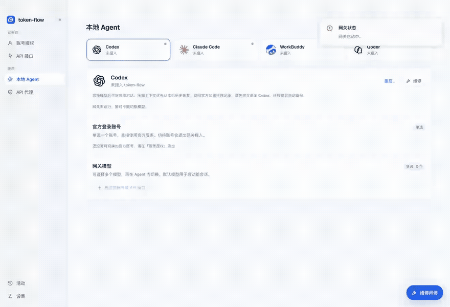
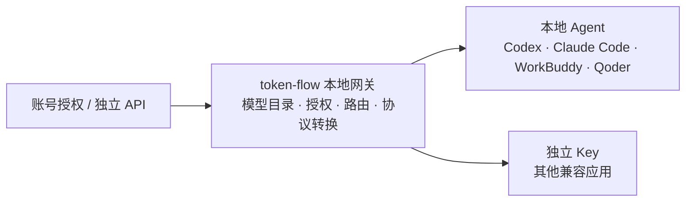

<div align="center">
  
  <h1>token-flow</h1>
  <p><strong>让你的模型，流向每个 Agent。</strong></p>
  <p>管理模型账号与 API · 跨来源选择模型 · 接入日常开发工具</p>
</div>

token-flow 是本地运行的桌面模型网关。把已授权账号和独立 API 汇入同一个模型目录，再接入 Codex、Claude Code、WorkBuddy、Qoder，或为其他兼容应用生成独立 Key。

你继续在熟悉的 Agent 里工作，token-flow 负责来源选择、模型路由、协议转换、客户端授权、用量记录和接入维修。

## 看一遍怎么用



**[观看完整中文字幕视频](docs/media/quickstart.mp4)** · [详细使用指南](docs/usage.md) · [产品功能与优化说明](docs/product.md) · [演示内容与复现方法](docs/demo.md)

演示录制于真实 Electron 界面，使用虚构账号、临时配置目录和本机模拟接口。展示操作流程，未展示真实厂商授权或目标 Agent 的实际对话。GIF 是视频的精简版。

## 核心功能

| 功能 | 能解决什么问题 |
| --- | --- |
| 多平台、多账号授权 | 按平台查看账号、模型及可查询额度；支持的来源可从本机导入授权。 |
| 多 API 接口 | 保存多个独立入口及模型；添加时用最小文本请求识别 Responses、Chat Completions 或 Messages 协议。 |
| 跨来源多选模型 | 按来源账号展开模型，搜索厂商、账号或模型；一次配置多个模型，并指定默认模型。 |
| 本地 Agent 接入 | 给 Codex、Claude Code、WorkBuddy、Qoder 写入受管配置与模型菜单，写前备份，可恢复原接口。 |
| 官方登录切换 | 支持的客户端可切换原生账号；Codex 切回官方时先核对凭据并恢复原接口。 |
| API 代理与独立 Key | 为应用选择可调用模型；管理已有 Key 权限、停用或删除，新增来源不会自动扩大权限。 |
| 长会话与上下文 | 适配来源的历史续接与压缩；受管 Codex 优先从本机历史恢复压缩上下文，切模型后继续原对话。 |
| 维修师傅 | 常驻维修对话、检查工具，以及无需维修模型的配置修改预览与人工执行。 |
| 用量与活动 | 账号、API、模型与 Key 的用量详情；请求状态、输入 / 输出 tokens 和配置切换记录。 |

完整功能、优化作用、兼容边界及验证依据见 [产品说明](docs/product.md)。

## 四步开始使用

1. 在 **账号授权** 添加账号，或在 **API 接口** 填写名称、URL、API Key 和模型，点击 **验证并添加**。
2. 在 **本地 Agent** 选择目标，打开 **选择模型**，展开来源并勾选模型，点击 **应用所选模型**。
3. 保存工作，重启需要加载配置的 Agent；在客户端模型菜单选择对应模型，发起实际任务。
4. 到 **活动** 核对请求；出问题打开 **维修师傅**。需要撤回接入时点击 **恢复原配置**。

其他应用：在 **API 代理** 创建 Key，设置名称、用途和模型权限，将接入地址、Key 与模型 ID 填到目标应用。上游 API Key 与导出的本地 Key 是不同凭据。

## 来源与客户端

项目包含 Codex、Claude、Antigravity、Kimi、xAI、Qoder IDE、WorkBuddy、ZCode、Doubao、Trae 的登录或本地授权导入适配，以及独立 Cursor SDK 入口。实际连接方式、模型与额度以界面及账号权限为准。

| 目标客户端 | 当前接入方式 |
| --- | --- |
| Codex | 自动配置接口与模型目录，多模型菜单、默认切换、官方账号切回及本机历史恢复。 |
| Claude Code | Messages 接口，主模型与辅助模型配置、多模型菜单；旧版可用 `/model 模型ID`。 |
| WorkBuddy | 写入自定义模型，重启后在任务输入框的模型菜单选择。 |
| Qoder 独立应用 | 写入自定义供应商与模型；需要版本和账号支持自定义模型。与 Qoder IDE 授权不同。 |
| Cursor / 其他兼容应用 | 导出 Key 手动接入。Cursor 的此类接入需要外网可访问的 HTTPS 网关。 |

授权成功、模型目录读取、额度查询、网关请求和目标客户端调用是不同证据。具体模型、工具、图片和客户端版本仍需实际验证。模型工具调用交回目标 Agent 执行，文件、Shell、MCP、审批和沙箱继续由目标 Agent 管理。

## 工作方式



Electron 与 React 提供桌面界面，Node.js 服务管理账号、配置、Key 与维修，CLIProxyAPI sidecar 负责来源适配和协议转换。

## 从源码启动

需要 Git、Node.js **22.19+**、npm，以及编译 sidecar 所需的 Go **1.26+**。

```bash
git clone https://github.com/haruinia/token-flow.git
cd token-flow
npm ci
node scripts/fetch-upstream.mjs
npm run sidecar:build
npm run dev
```

获取脚本检出固定上游版本并应用来源补丁；冲突时停止并保留本地修改。需要辅助浏览器能力或浏览器测试时安装 Chromium：`npm run browser:install`。

| 命令 | 用途 |
| --- | --- |
| `npm run check` | 类型检查、自动化测试、生产构建。 |
| `npm run test:frontend` | 隔离 Electron 界面回归：账号、API、多模型、Key、维修与不同窗口宽度。 |
| `npm run test:api-sources` | 桌面 API 来源与凭据跨重启验证。 |
| `npm run test:sidecar-agents` | 模拟上游的来源执行器与协议转换测试。 |
| `npm run demo` | 录制隔离演示，生成中文字幕 MP4、GIF 和截图，需要 FFmpeg。 |
| `npm run package` | 生成本地桌面目录包，不自动发布安装包。 |
| `npm run package:win` | 构建 Windows sidecar 与 ZIP 包，需对应平台验证。 |

本次全量测试仍有一项旧浏览器标签页场景间歇失败，独立复查通过；完整结果见 [2026-10-12 验证记录](docs/release-2026-10-12.md)。

## 数据与隐私

- 桌面资料保存在系统应用数据目录，可用 `AGENT_DATA_ROOT` 指定独立目录；headless 默认使用 `.data/`。
- API 来源及可持久保存的客户端 Key 使用桌面安全存储加密。列表默认隐藏密钥；显式点击显示 / 复制时，受保护的本机接口会读取密钥。授权文件与完整配置备份同样需要妥善保管。
- 无界面服务没有持久化安全密钥存储，不接受新增 API 密钥的持久保存。
- 请求会发送到所选来源；来源权限、套餐和规则继续适用。来源停用或授权失效会明确失败，不自动换账号。
- 账号、密钥、会话、缓存、日志、备份和安装包不提交。`docs/media/` 只收录检查过的隔离演示素材。
- 旧 API 迁移先备份并保留旧设置，不自动改写客户端；代码回退不能代替运行数据恢复。

## 项目结构与文档

```text
apps/console/        React 界面
apps/desktop/        Electron 桌面应用
packages/core/       网关、来源授权、额度、接入与维修
packages/contracts/  共享协议与类型
patches/cliproxy/    sidecar 来源补丁及构建覆盖文件
scripts/             构建、验证与演示工具
tests/               自动化测试
docs/                产品、使用指南、演示与历史阶段记录
LICENSES/            第三方许可
```

[P0](docs/product-refactor-p0.md)、[P1](docs/product-refactor-p1.md)、[P2](docs/product-refactor-p2.md) 为当时阶段记录；当前界面与能力以 [产品说明](docs/product.md) 和 [使用指南](docs/usage.md) 为准。

问题与建议：[GitHub Issues](https://github.com/haruinia/token-flow/issues)。项目采用 [MIT 许可](LICENSE)，第三方复用见 [THIRD_PARTY.md](THIRD_PARTY.md)。
