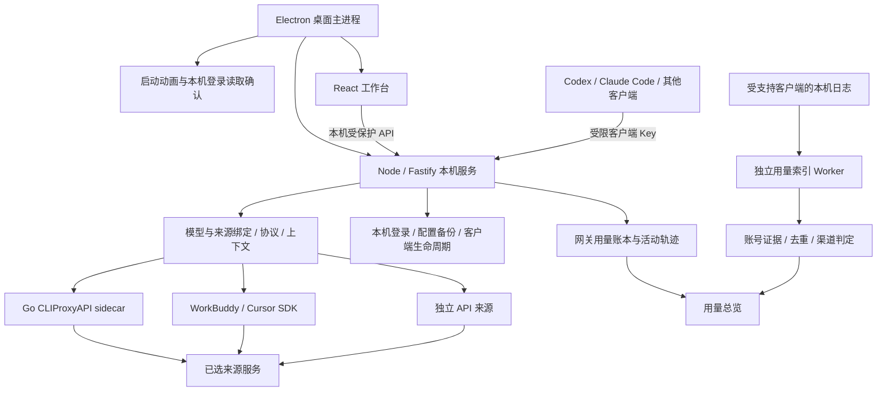

# 项目架构

依据当前源码整理于 2026-10-16。这里说明模块职责和数据流，不代表每个平台均已完成实机验收。

## 运行结构

TokenFlow 由 Electron 桌面壳、React 界面、Node 本机网关和来源执行器组成。来源账号与目标客户端分别管理：例如 Claude Code 是目标客户端，反重力是模型来源，反重力来源中的 Claude 模型仍消耗反重力账号额度。

桌面本机服务默认监听 `127.0.0.1:9527`，sidecar 默认端口为 8317，均可通过配置调整。界面展示“网关运行中”只能说明服务状态；账号加载、来源网络、凭据交换和客户端实际调用分别验证。

## 目录与职责

| 目录／入口 | 职责与修改位置 |
| --- | --- |
| [apps/desktop/src/main.ts](../apps/desktop/src/main.ts) | 创建桌面窗口、托盘、启动顺序、本机服务和受限 IPC；主题、关闭与驻留行为从这里接入 |
| [apps/desktop/src/startup-window.ts](../apps/desktop/src/startup-window.ts)、[credential-access.ts](../apps/desktop/src/credential-access.ts) | 启动页面与读取客户端安全存储之前的选择；“暂不读取”约束本次启动的相关访问 |
| [apps/desktop/src/secrets.ts](../apps/desktop/src/secrets.ts) | Electron 系统加密存储；与各客户端自己的登录存储分别处理 |
| [apps/console/src](../apps/console/src) | React 页面与交互；账号授权、Agent 接入、独立 API、用量、活动、设置、维修和清理 |
| [packages/core/src/service.ts](../packages/core/src/service.ts) | 本机 API 与服务装配；创建存储、执行器、生命周期、统计模块并连接请求处理 |
| [cliproxy.ts](../packages/core/src/cliproxy.ts)、[login/](../packages/core/src/login) | sidecar 生命周期、账号与动态目录、授权会话及阶段诊断 |
| [quota/](../packages/core/src/quota) | 各来源的额度接口和显示窗口；不将周／5 小时百分比换算成 Token 用量 |
| [api-sources.ts](../packages/core/src/api-sources.ts)、[gateway-keys.ts](../packages/core/src/gateway-keys.ts) | 独立上游来源、密钥与客户端 Key 的授权范围；创建或切换模型不自动扩大既有 Key 权限 |
| [agent-connections.ts](../packages/core/src/agent-connections.ts) | 接入配置生成、备份、版本检查、重新应用与恢复；只改接入所需字段 |
| [codex-switch-lifecycle.ts](../packages/core/src/codex-switch-lifecycle.ts)、[windows-agent-lifecycle.ts](../packages/core/src/windows-agent-lifecycle.ts) | Codex 退出→变更→重开与 Windows 进程身份、安装入口检查 |
| [codex-accounts.ts](../packages/core/src/codex-accounts.ts)、[claude-accounts.ts](../packages/core/src/claude-accounts.ts)、[antigravity-accounts.ts](../packages/core/src/antigravity-accounts.ts)、[desktop-accounts.ts](../packages/core/src/desktop-accounts.ts) | 各客户端原生登录读取、切换与原登录恢复，不等同于网关模型来源绑定 |
| [codex-thread-migration.ts](../packages/core/src/codex-thread-migration.ts)、[codex-context.ts](../packages/core/src/codex-context.ts) | Codex 历史、来源标记、索引和上下文兼容；操作需保留恢复依据 |
| [codebuddy.ts](../packages/core/src/codebuddy.ts)、[cursor-protocol.ts](../packages/core/src/cursor-protocol.ts) | SDK 来源与网关协议边界；配套实现分布在相邻 `codebuddy-*`、`cursor-*` 模块 |
| [gateway-maintenance.ts](../packages/core/src/gateway-maintenance.ts)、[maintenance-approval.ts](../packages/core/src/maintenance-approval.ts) | 维修会话与配置变更预览、确认、版本保护 |
| [file-cleanup.ts](../packages/core/src/file-cleanup.ts) | 文件元数据扫描、风险分类及再次校验；桌面回收站能力由 Electron 注入 |
| [patches/cliproxy](../patches/cliproxy)、[scripts](../scripts) | Go 上游覆盖层、构建和验证脚本；`upstream/` 是构建取回的上游工作区，不能当成项目源代码直接长期修改 |
| [tests](../tests)、[doc](README.md) | 自动化测试与统一文档入口；原始运行数据不在文档目录混放 |

## 三条主要流程

### 授权和来源发现

界面启动授权 → `login/` 创建会话与回调 → 登录或凭据交换 → 保存来源账号 → sidecar／SDK 发现该账号模型 → `quota/` 独立查询额度 → 界面更新。浏览器显示登录成功不等于凭据已保存；诊断应分别记录回调、交换、保存、目录和额度阶段，不能输出完整回调网址或 Token。

### 客户端接入和请求

用户选择来源与模型 → 创建绑定来源的客户端 Key → 备份并写入目标配置 → 按目标规则重启 → 客户端发送请求 → 校验 Key 与模型权限 → 按选定来源执行 → 转换协议与用量。

外部工具更改配置时可明确选择“重新应用”：使用确认时的版本，先保存替换前原文，再更新接入字段。它不是持续监控并抢回配置的后台循环。其他工具再次写入、配置损坏或文件无法写入时，应停止并保留可恢复状态。

### 用量统计

- 网关：请求携带 `sourceId / model / keyId / target`，上游返回实际 usage 后写入 [usage-ledger.ts](../packages/core/src/usage-ledger.ts)；失败和未计量请求单独计数。
- 本机：客户端日志经 [local-usage-index.ts](../packages/core/src/local-usage-index.ts) 和 [local-usage-worker.ts](../packages/core/src/local-usage-worker.ts) 索引，通过 [usage-attribution.ts](../packages/core/src/usage-attribution.ts)、[native-usage-logins.ts](../packages/core/src/native-usage-logins.ts) 关联请求证据或有效登录时间段；证据不足保留未知。
- 展示：`/api/usage/overview` 合并网关与去重后的本机行；前端 [usage-data.ts](../apps/console/src/usage-data.ts)、[usage-model.ts](../apps/console/src/usage-model.ts) 统一筛选与汇总。

反重力目前是受支持的来源和原生登录切换对象，但不在本机用量 Worker 的采集目标中。额度查询成功不能替代反重力客户端直连 Token 采集。具体测试与缺口见 [用量验证](testing/usage-attribution.md)。

## 数据、构建与边界

桌面资料根目录由 [profile.ts](../apps/desktop/src/profile.ts) 统一选择，可通过 `AGENT_DATA_ROOT` 指向独立测试目录；headless 默认使用项目 `.data/`。客户端自己的配置目录由 `agentPaths()` 等模块解析，不是 TokenFlow 数据根目录的子目录。

主要本机资料包括 `secrets/`、`cliproxy/auth/`、`agent-backups/`、`usage-ledger.json`、本机用量索引及归属证据。账号、完整备份和认证文件不得提交仓库。配置备份用于客户端恢复，Git 用于软件版本回溯，两者作用不同。

[tsup.config.ts](../tsup.config.ts) 构建桌面主进程、preload、headless 和用量 Worker；Vite 构建界面。Go sidecar 按平台构建并放入包资源，SDK／原生依赖由打包脚本处理。`package*` 入口会清理临时产物；构建前先确认需要保留的验证结论已归档。

`service.ts` 当前仍承担较多装配和路由工作。本轮整理的是职责与文档位置，没有移动运行模块或改变服务边界。后续拆分应按授权、客户端接入、用量等 API 组逐步进行，并保留对应集成测试，见 [TODO](TODO.md)。
