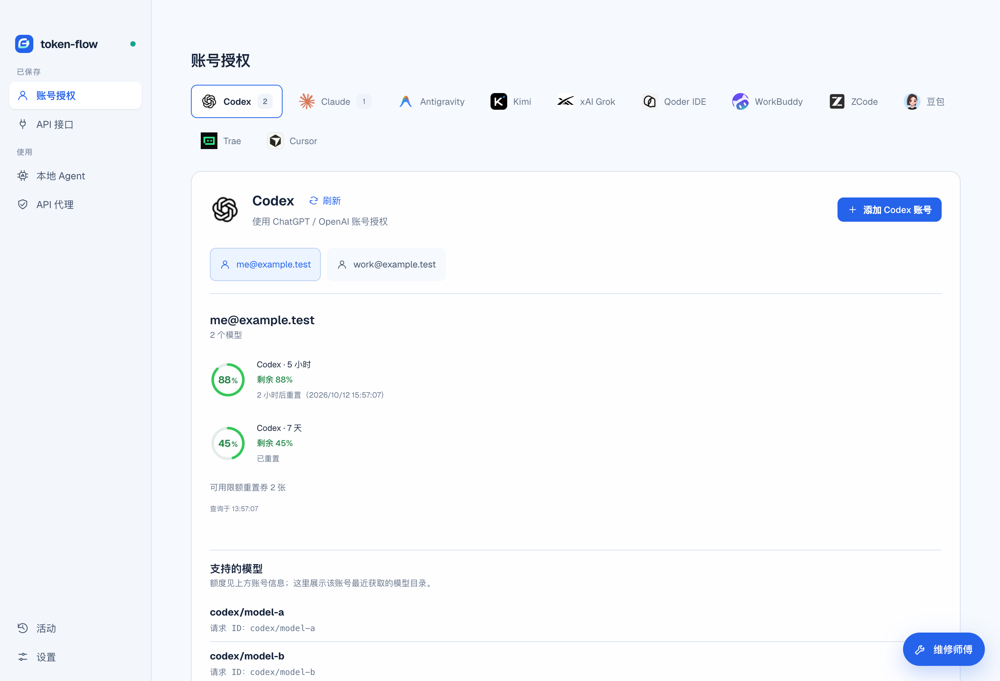
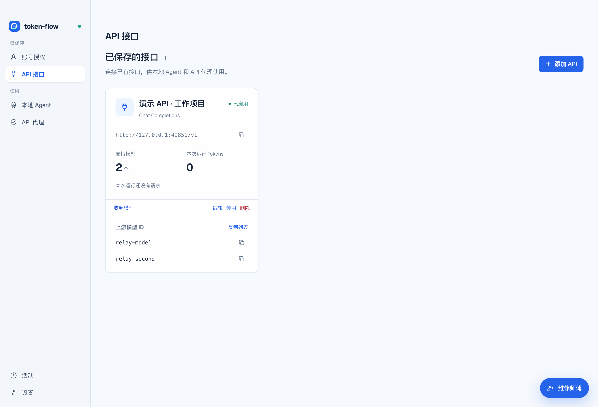
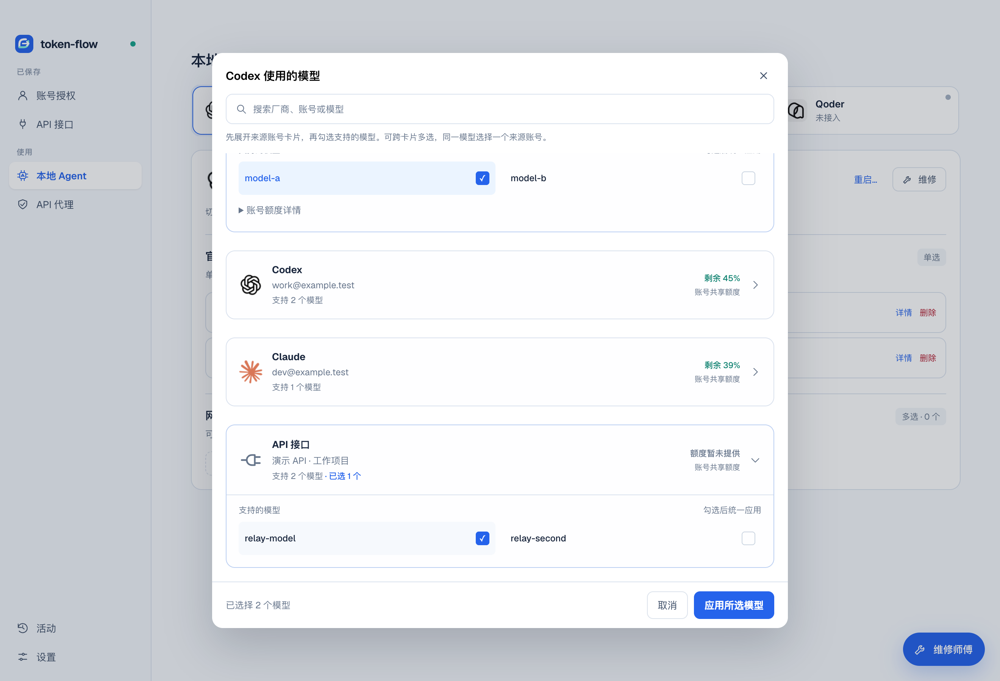
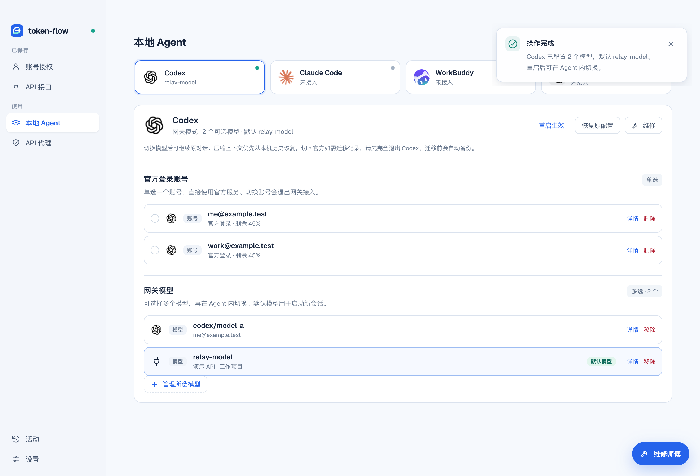
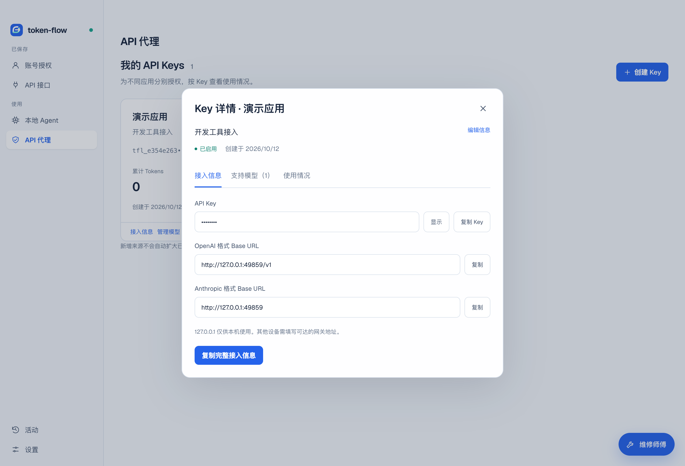
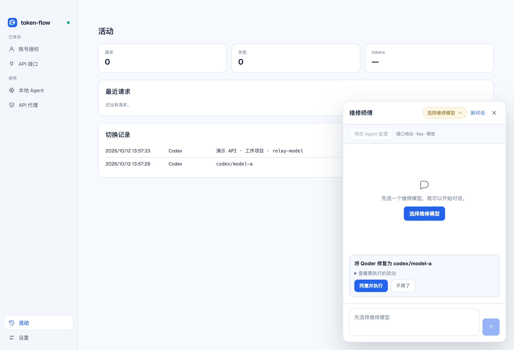

# 中文使用演示

[观看 MP4 视频](media/quickstart.mp4) · [查看精简 GIF](media/quickstart.gif) · [文字使用指南](usage.md)

视频为真实 Electron 界面操作录制，带中文步骤字幕，无音轨。GIF 将同一段录像加速为 4 倍，适合快速预览；完整说明请看原速 MP4。

## 演示内容

| 顺序 | 操作与说明 |
| --- | --- |
| 01 | 平台账号、账号标签、模型与共享额度。 |
| 02 | 添加 API 名称 / URL / Key，添加多个模型，最小验证识别协议，查看模型列表。 |
| 03 | Codex 跨来源多选模型、应用配置、重启提示、切换默认模型。 |
| 04 | 为其他应用创建独立 Key，限定模型，查看接入信息。 |
| 05 | 活动页中的请求及配置切换记录。 |
| 06 | 无需维修模型的配置修改，先预览方案，再批准执行。 |

演示使用 `example.test` 虚构账号、一次性凭据、临时 HOME 和配置目录、本机模拟上游及模拟 sidecar。真实界面和配置写入运行于隔离环境；不读取个人账号、不调用付费模型、不重启用户的 Agent、不升级软件。密钥输入隐藏，包括首次生成的本地演示 Key。

模型名 `model-a` / `relay-model` 是夹具名，不代表真实厂商可用模型。演示中的配置成功不能当作真实客户端调用通过。

## 界面截图

账号和模型：



API 多模型来源：



跨来源模型选择：



Agent 默认模型：



应用独立 Key：



配置维修预览：



## 重新录制

先按 [README](../README.md#从源码启动) 安装依赖，再安装 FFmpeg；桌面录制还需要系统能启动 Electron 及 Playwright 的录制组件。运行：

```bash
npm run demo
```

脚本 [`record-demo.mjs`](../scripts/record-demo.mjs) 复用当前界面测试中的隔离夹具方式，断言多模型配置、协议识别、Key 默认隐藏、预览不写配置及批准后写入；操作有错误时停止，不生成成功视频。

发布素材写入 `docs/media/`，原始 WebM 和字幕分镜时间写入已忽略的 `output/playwright/product-demo/`。过程结束后删除临时配置目录。运行不会自动提交、推送或发布；更新素材时先检查画面，再纳入 Git。
